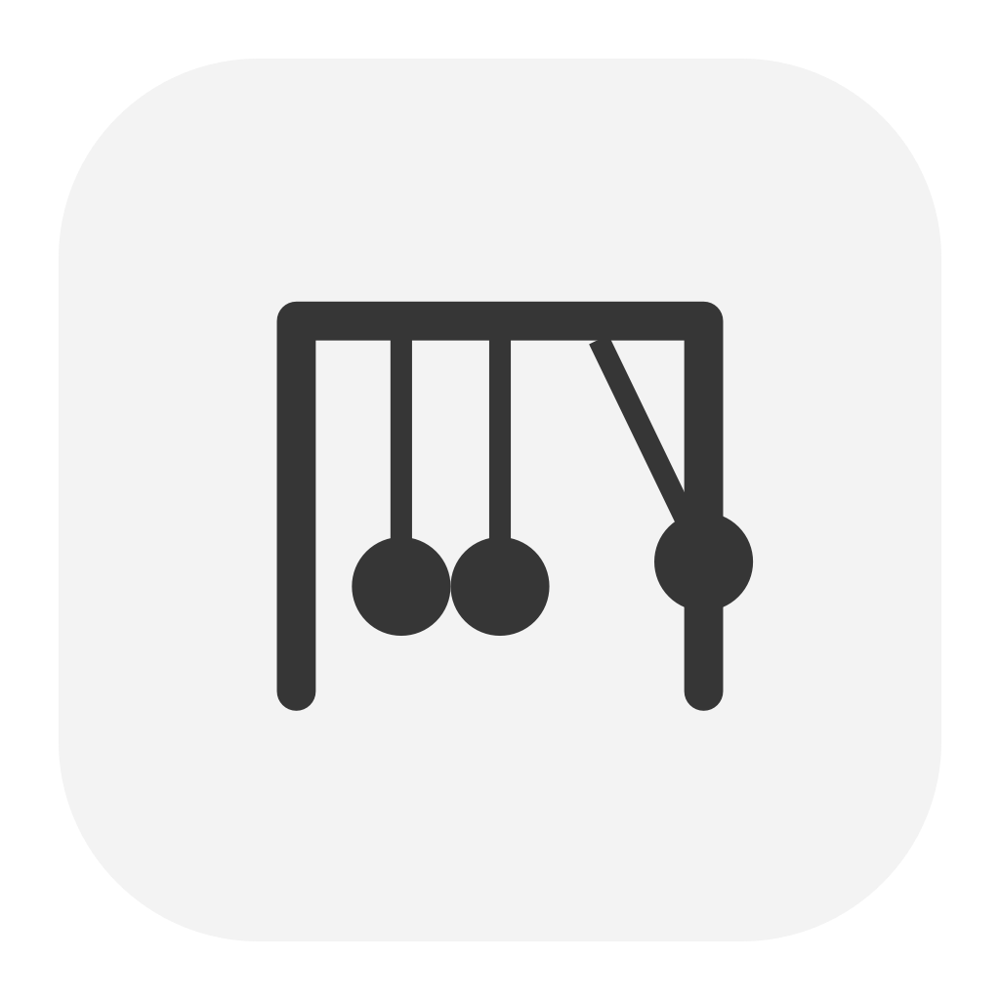

<p align="center">
  
</p>
<h1 align="center">Swingset</h1>
<p align="center">Ten small things to play with.</p>
<p align="center">
  
  
  
  <a href="LICENSE"></a>
</p>

Swingset is a little box of fidget toys for your Mac. Spin a bearing, pop bubble wrap, flip a switch or slide wooden beads. Play in the app or pin a toy to your desktop with [Cork](https://github.com/Upsidedly/cork). It shares a monochrome style with [Tuck](https://github.com/Upsidedly/tuck), [Snap](https://github.com/Upsidedly/snap) and [Cell](https://github.com/Upsidedly/cell).

## Pick something up

Choose a toy in the sidebar, then click, drag or flick it. Each has its own response: coasting, spring tension, magnetic attraction, detents or momentum transfer.

| Toy | Play |
| --- | --- |
| Spinner | Flick the bearing and let it coast. |
| Bubble Wrap | Pop 24 bubbles, then reset for a fresh sheet. |
| Clicker | Press the button; its counter remembers each click. |
| Switchboard | Flip eight metal switches. |
| Brass Gears | Turn either gear and watch the other follow. |
| Abacus | Slide wooden beads and push their neighbours. |
| Magnets | Pull a chrome puck away and let it return. |
| Elastic | Stretch the rubber band and release it. |
| Zipper | Slide the pull through the teeth. |
| Newton's Cradle | Lift an end ball and pass the motion along. |

Sound starts off. Enable **Sound** for synthesized pops, clicks and taps, or **Haptics** for feedback on supported Mac trackpads. Your choices save automatically.

Focus a toy and press **Space**, **Return** or an arrow key to play. Left/down reverse rotary toys. Press **R** to reset, or use the native **Reset** button (**⌘0**).

Your selected toy, preferences, counter, bubbles, switches and toy positions restore when you reopen Swingset. Motion pauses while the app is inactive or the display sleeps. Settled toys stop animating. Reduce Motion shortens automatic movement while keeping direct manipulation.

## Put a toy on your desktop

Install [Cork](https://github.com/Upsidedly/cork) in Applications. Pick a toy in Swingset and click **Add to Cork** (**⇧⌘A**). Swingset sends its local widget package, selected toy and current state through Cork's bundled MCP bridge.

The desktop widget is just the physical toy, with a transparent surround. Cork places it around fixed items and fits the photos around it. It stays playable while the desktop is locked; choose **Edit Desktop** in Cork to move or resize it.

You can quit Swingset afterward. Cork owns a copy and saves each desktop toy independently. The two copies do not sync. Add another instance for a separate toy. Sound and haptics come from the choices saved when you add it; press **R** to reset a focused desktop toy.

## Install from source

Use macOS 14 or later with Swift 6 and a compatible macOS SDK.

```sh
git clone https://github.com/Upsidedly/swingset.git
cd swingset
./scripts/install.sh
open /Applications/Swingset.app
```

Quit Swingset before updating it. The script builds and signs the app locally, backs up an earlier installation and leaves saved toys intact. There is no notarized download yet.

## Privacy

Swingset needs no account, Accessibility, Screen Recording or microphone permission. It runs bundled drawing and physics code locally in WebKit, with no runtime packages, remote scripts, tracking or uploads. Sounds are synthesized; nothing is recorded.

Saved state stays in `~/Library/Application Support/Swingset/shelf.json`. Cork's separate permissions apply only to its own screenshot and cross-app minimize features.

## Development

Build with `./scripts/build.sh`. Run the model checks with `node Tests/physics.test.js`. Set `SWINGSET_SDK` to use another compatible SDK without changing global Xcode settings.

See [development and verification](docs/DEVELOPMENT.md) for the app structure and tested limits. Other apps can supply widgets through [Cork's registration format](https://github.com/Upsidedly/cork/blob/main/docs/WIDGETS.md).

## License

Copyright © 2026 Upsidedly. Swingset is free software under the **GNU Affero General Public License, version 3 or later**. See [LICENSE](LICENSE) and [COPYRIGHT](COPYRIGHT).
